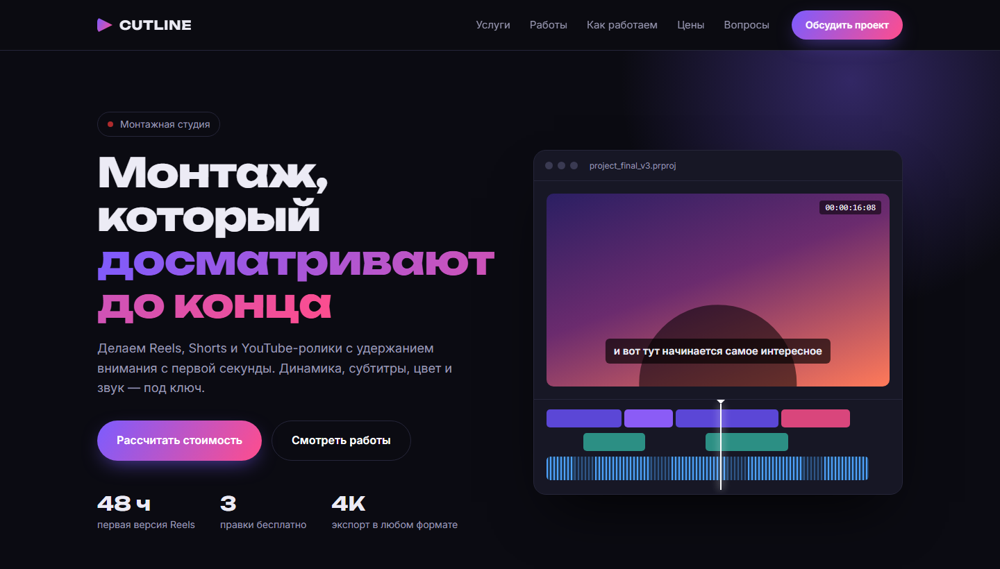

# CUTLINE — лендинг студии видеомонтажа

**[Открыть сайт →](https://mahn1.github.io/video-editing-landing/)**

Одностраничный сайт для студии монтажа Reels, YouTube-роликов и видео с мероприятий. Тёмная «киношная» стилистика, анимированное окно монтажной программы в первом экране.

## Что внутри

- **Первый экран** с анимированной монтажной шкалой: бегущий плейхед, звуковая дорожка, тайм-код
- **Портфолио** с фильтром по типу работ (Reels / YouTube / мероприятия)
- **Тарифы** с переключением вкладок — данные берутся из одного JS-объекта, легко менять цены
- **Вопросы и ответы** на нативных `
` — работают даже без JavaScript
- **Форма заявки** с проверкой обязательных полей и сообщением об успешной отправке
- Адаптивная вёрстка: ПК, планшет, телефон, мобильное меню
- Учитывает `prefers-reduced-motion` — анимации отключаются, если пользователь их не любит

## Стек

HTML5 · CSS3 (Grid, Flexbox, custom properties) · чистый JavaScript без библиотек · Google Fonts (Unbounded, Inter)

## Запуск

Сборка не нужна: откройте `index.html` в браузере.

---

Демо-проект для портфолио: студия, отзывы и контакты вымышлены, форма никуда не отправляет данные.
